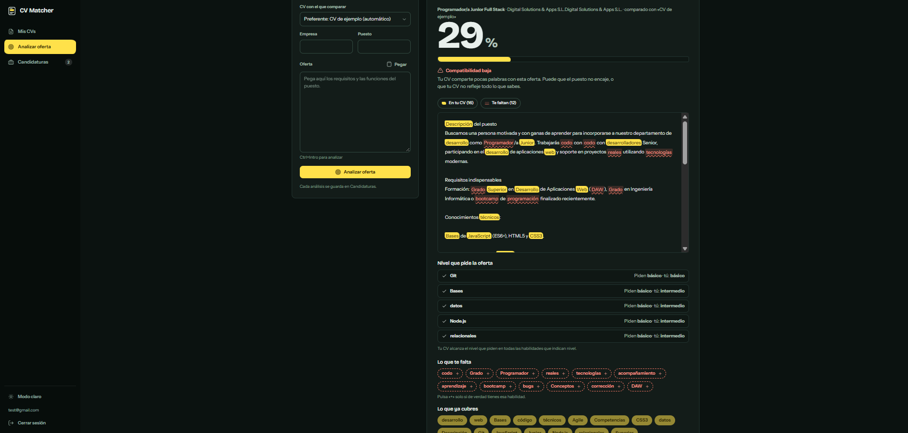
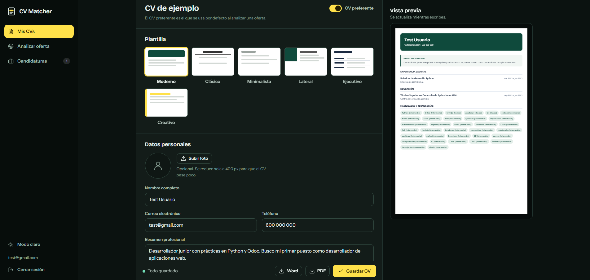
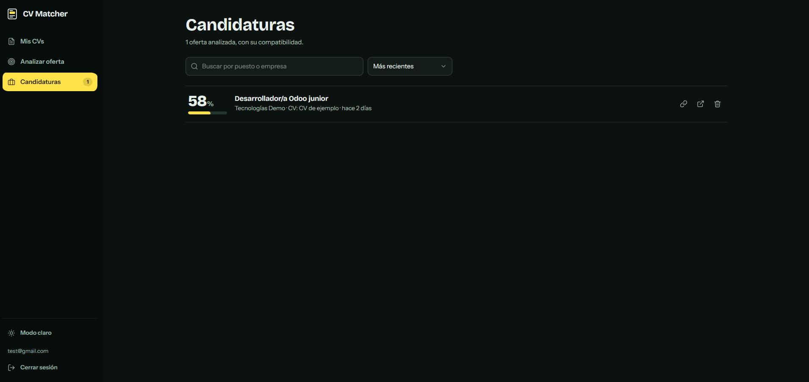
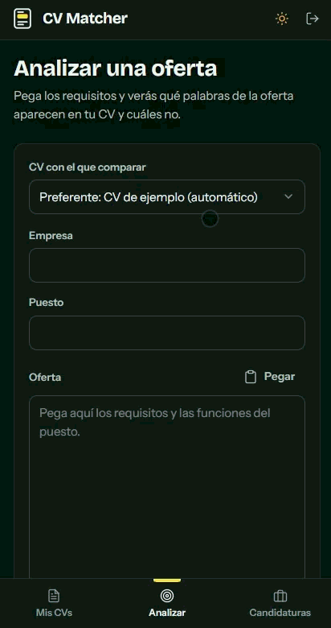

# CV Matcher

Aplicación web para **crear y gestionar varios CVs** y **medir cuánto encaja cada uno con una oferta de trabajo**. Pegas una oferta y la app te dice el porcentaje de compatibilidad, qué palabras clave ya están en tu CV y cuáles te faltan, y te deja añadirlas con un clic.

Proyecto personal de portafolio: backend en Node.js/Express con MySQL y front end en JavaScript vanilla, sin frameworks.

<!-- DEMO EN LÍNEA: cuando la publiques, descomenta la línea siguiente y pon tu URL
**🔗 [Probar la demo](https://TU-URL)** · sin registro, con datos de ejemplo
-->



> Las capturas usan datos de ejemplo.

## Índice

- [Funcionalidades](#funcionalidades)
- [Capturas](#capturas)
- [Tecnologías](#tecnologías)
- [Cómo funciona el análisis](#cómo-funciona-el-análisis-de-ofertas)
- [Instalación en local](#instalación-en-local)
- [Configuración](#configuración)
- [Publicar una demo](#publicar-una-demo)
- [Tests](#tests)
- [Estructura](#estructura-del-proyecto)
- [API](#api)
- [Seguridad y privacidad](#seguridad-y-privacidad)
- [Limitaciones y próximos pasos](#limitaciones-conocidas)

## Funcionalidades

**Currículums**
- Varios CVs por usuario, con CV preferente, duplicado y borrado.
- Editor con vista previa en vivo y 6 plantillas: Moderno, Clásico, Minimalista, Lateral, Ejecutivo y Creativo.
- Foto de perfil que se reduce sola en el navegador.
- Comentario en cada experiencia y estudio para explicar qué hiciste (también cuenta para el análisis).
- Importar un CV existente (PDF, DOCX o TXT) y rellenar los campos automáticamente. Con una clave de la API de Claude el análisis es más preciso; sin ella usa un analizador básico.
- Exportar a PDF con texto real, compatible con ATS, y a Word (`.doc`).

**Análisis de ofertas**
- Porcentaje de compatibilidad entre el CV elegido y la oferta.
- La oferta se muestra con las palabras marcadas: amarillo si están en tu CV, coral si faltan.
- Descarta palabras genéricas (ágil, carrera, colaborar…) y cuenta una sola vez las variantes de la misma palabra.
- Detecta el **nivel** que pide la oferta («Python avanzado») y lo compara con el que marcaste en tu CV.
- Botón «+» para añadir una habilidad que falta sin salir de la pantalla: el porcentaje se recalcula al momento.
- Historial de **candidaturas** con búsqueda, orden por fecha o compatibilidad y enlace público de cada una.

**Cuenta y privacidad**
- Registro, inicio de sesión (JWT) y recuperación de contraseña por correo.
- **Mi cuenta**: descargar todos tus datos en JSON y eliminar la cuenta y todo su contenido.
- Páginas de privacidad, términos y aviso legal.
- **Modo demo** opcional: botón «Probar la demo» que crea una cuenta temporal de 24 h con datos de ejemplo.

**Interfaz**: modo claro/oscuro, adaptada a móvil, atajos de teclado (Ctrl+S guarda, Ctrl+Intro analiza) y aviso de cambios sin guardar.

## Capturas

| Plantillas |
|---|
|  |

| Candidaturas | Móvil |
|---|---|
|  |  |

## Tecnologías

| Capa | Herramientas |
|---|---|
| Servidor | Node.js, Express 5 |
| Base de datos | MySQL / MariaDB (`mysql2`) |
| Autenticación | JWT (`jsonwebtoken`), `bcryptjs` |
| Archivos | `multer`, `pdf-parse`, `mammoth` |
| Correo | `nodemailer` |
| IA (opcional) | API de Claude (Anthropic) para importar CVs |
| Front end | HTML, CSS y JavaScript vanilla (módulos ES), sin compilación |
| PDF | Impresión del navegador («Guardar como PDF»): el texto queda seleccionable |
| Tests | `node:test`, sin dependencias |

## Cómo funciona el análisis de ofertas

El cálculo está en `src/utils/matchCalculator.js` y se basa en **coincidencia de términos**, no en significado:

1. Extrae las palabras clave de la oferta, ignorando palabras vacías y genéricas en español e inglés.
2. Normaliza tildes, ñ, mayúsculas y variantes (género, número y terminaciones habituales) para contar una palabra una sola vez.
3. Pondera cada palabra según cuántas veces aparece en la oferta.
4. Busca cada una en el CV: título, resumen, habilidades, puestos, empresas, estudios y sus comentarios.
5. Si la oferta pide un nivel («avanzado») y tu habilidad tiene uno menor, cuenta como **coincidencia parcial**.
6. El porcentaje es el peso de lo encontrado sobre el peso total.

No entiende sinónimos ("JS" y "JavaScript" son palabras distintas).

## Instalación en local

**Requisitos:** Node.js 20 o superior y MySQL 8 / MariaDB.

```bash
# 1. Clonar e instalar
git clone https://github.com/jesus-jbg/cv-matcher.git
cd cv-matcher
npm install

# 2. Crear la base de datos (las tablas se crean solas al arrancar)
mysql -u root -p -e "CREATE DATABASE cv_matcher_db CHARACTER SET utf8mb4;"

# 3. Configurar
cp .env.example .env        # en Windows: copy .env.example .env
# Rellena como mínimo DB_PASSWORD y JWT_SECRET

# 4. Arrancar
npm start
```

Abre <http://localhost:3000>. Para desarrollo con recarga automática: `npm run dev`.
También puedes crear la base e importar `schema.sql` desde phpMyAdmin.

**Datos de ejemplo** (solo desarrollo local): `npm run seed` crea el usuario `test@gmail.com` / `1234` con un CV y una candidatura. `npm run seed:reset` **borra todos los datos** y deja solo los de ejemplo. No crees esa cuenta en un servidor público.

## Configuración

Todas las variables están comentadas en [`.env.example`](.env.example). **Nunca subas tu `.env` a GitHub.**

| Variable | Obligatoria | Descripción |
|---|---|---|
| `JWT_SECRET` | Sí | Clave para firmar tokens (mínimo 16 caracteres). Sin ella el servidor no arranca. |
| `DB_HOST`, `DB_USER`, `DB_PASSWORD`, `DB_NAME` | Sí | Conexión a MySQL. |
| `DB_PORT`, `DB_SSL` | No | Puerto y conexión cifrada (`DB_SSL=true` en bases de datos en la nube). |
| `PORT`, `APP_URL` | No | Puerto (3000 por defecto) y dirección pública para los enlaces de los correos. |
| `SMTP_HOST`, `SMTP_PORT`, `SMTP_USER`, `SMTP_PASS`, `MAIL_FROM` | No | Envío de correos. Sin `SMTP_HOST`, el enlace de recuperación sale por la consola del servidor. |
| `ANTHROPIC_API_KEY` | No | Activa el análisis con IA al importar un CV. Déjala vacía en una demo pública. |
| `DEMO_MODE` | No | `true` muestra «Probar la demo» (cuenta temporal de 24 h). |
| `REGISTRATION_OPEN` | No | `false` cierra el registro de cuentas nuevas. |
| `TRUST_PROXY` | No | `1` detrás de un proxy (Render, Railway…), para limitar intentos por IP real. |
| `AUTO_SCHEMA` | No | Crea las tablas si la base está vacía (por defecto); `false` lo desactiva. |
| `LEGAL_EMAIL` | Al publicar | Correo de contacto de los textos legales. |
| `LEGAL_NAME`, `LEGAL_PLACE`, `LEGAL_HOSTING` | No | Titular, localidad y proveedores que figuran en los textos legales. |

Para generar un `JWT_SECRET`:

```bash
node -e "console.log(require('crypto').randomBytes(32).toString('hex'))"
```

**Correo con Gmail:** activa la verificación en dos pasos, crea una *contraseña de aplicación* y úsala como `SMTP_PASS` con `SMTP_HOST=smtp.gmail.com` y `SMTP_PORT=587`.

## Publicar una demo

La guía paso a paso (servicio Node + MySQL en la nube, variables y comprobaciones) está en [docs/DESPLIEGUE.md](docs/DESPLIEGUE.md). Resumen de lo importante: `DEMO_MODE=true`, `REGISTRATION_OPEN=false`, `DB_SSL=true`, `TRUST_PROXY=1`, un `JWT_SECRET` nuevo y `LEGAL_EMAIL`.

## Tests

```bash
npm test
```

Cubren el cálculo de compatibilidad (genéricas, variantes, niveles, ñ y tildes, comentarios) y la parte de cuenta (descargar datos, eliminar cuenta con y sin contraseña, textos legales). No necesitan base de datos.

## Estructura del proyecto

```
cv-matcher/
├── schema.sql              # Tablas de la base de datos
├── docs/                   # Guía de despliegue y capturas
├── scripts/seed.js         # Datos de ejemplo (npm run seed)
├── test/                   # Pruebas (node:test)
├── src/
│   ├── app.js              # Servidor Express, rutas y textos legales
│   ├── config/             # Conexión MySQL, secreto JWT y migración automática
│   ├── controllers/        # Auth, CVs, importación y candidaturas
│   ├── middlewares/        # Verificación del token
│   ├── routes/             # Endpoints
│   ├── legal/              # Privacidad, aviso legal y términos
│   └── utils/              # Cálculo del match, PDF/DOCX, correo, límite de intentos, demo
└── public/                 # Front end (archivos estáticos)
    ├── index.html          # Entrar / registrarse / recuperar contraseña / demo
    ├── dashboard.html      # Mis CVs, Analizar oferta, Candidaturas, Mi cuenta
    ├── view.html           # Página pública de una candidatura
    ├── reset.html          # Contraseña nueva
    ├── styles.css
    └── js/                 # Módulos ES: cv.js, match.js, jobs.js, account.js, cv-preview.js…
```

## API

Las rutas con 🔒 requieren `Authorization: Bearer <token>`.

| Método | Ruta | Descripción |
|---|---|---|
| POST | `/api/auth/register` | Crear cuenta (contraseña de 8 caracteres como mínimo) |
| POST | `/api/auth/login` | Iniciar sesión y recibir el token |
| POST | `/api/auth/forgot-password` | Pedir el enlace de recuperación por correo |
| POST | `/api/auth/reset-password` | Fijar una contraseña nueva con el enlace recibido |
| GET | `/api/auth/config` | Qué ofrece el servidor (demo, registro abierto) |
| POST | `/api/auth/demo` | Crear una cuenta de demo temporal (con `DEMO_MODE=true`) |
| GET | `/api/auth/export` 🔒 | Descargar todos los datos de la cuenta |
| DELETE | `/api/auth/me` 🔒 | Eliminar la cuenta y todo su contenido (pide la contraseña, salvo en demo) |
| GET | `/api/cv/list` 🔒 | Lista de CVs |
| GET | `/api/cv/:id` 🔒 | Un CV completo |
| POST | `/api/cv/save` 🔒 | Crear o actualizar un CV |
| DELETE | `/api/cv/:id` 🔒 | Borrar un CV |
| POST | `/api/cv/import` 🔒 | Importar un CV desde PDF, DOCX o TXT (máx. 5 MB) |
| POST | `/api/jobs` 🔒 | Analizar una oferta y guardar la candidatura |
| GET | `/api/jobs` 🔒 | Lista de candidaturas |
| POST | `/api/jobs/:id/skills` 🔒 | Añadir una habilidad al CV y recalcular el porcentaje |
| DELETE | `/api/jobs/:id` 🔒 | Borrar una candidatura |
| GET | `/api/jobs/public/:slug` | Datos públicos de una candidatura |
| GET | `/privacidad`, `/terminos`, `/aviso-legal` | Textos legales |

## Seguridad y privacidad

- Contraseñas con bcrypt; el servidor no arranca sin un `JWT_SECRET` fuerte; sesiones de 24 h.
- Cada usuario solo accede a sus propios CVs y candidaturas. Consultas SQL parametrizadas y texto del usuario escapado en pantalla.
- Recuperación de contraseña con enlaces de un solo uso que caducan en 1 hora; solo se guarda su hash y la respuesta es la misma exista o no el correo.
- Límite de intentos en login, registro, demo, recuperación y borrado de cuenta.
- Sin cookies ni analítica: solo se guarda en el navegador el token de sesión y el tema.
- **RGPD**: el usuario puede descargar sus datos y eliminar su cuenta desde «Mi cuenta». Las cuentas demo se borran a las 24 h. Los archivos de CV que se importan se procesan en memoria y no se almacenan.
- El enlace público de una candidatura solo expone los campos que muestra la página.
- Los textos legales son orientativos para un proyecto personal sin fines comerciales; si la app se usara como servicio real, conviene que los revise un profesional.

## Limitaciones conocidas

- Para guardar el PDF hay que elegir «Guardar como PDF» en el cuadro de impresión (y desactivar «Encabezados y pies de página»).
- La página pública de una candidatura muestra nombre, correo y teléfono a quien tenga el enlace.
- El análisis compara palabras, no significados; la detección de niveles se basa en cercanía y puede fallar en frases con varias habilidades.
- El límite de intentos es en memoria: vale para un solo servidor.
- Las vulnerabilidades moderadas de `npm audit` vienen de `mammoth` y no tienen arreglo publicado; solo afectan a la importación de `.docx`.

## Próximos pasos

- [ ] CV público con URL propia y control de qué datos se muestran
- [ ] Estados de candidatura (enviada, entrevista, rechazada…) con notas
- [ ] Sugerencias con IA para adaptar el CV a cada oferta
- [ ] Idiomas, enlaces (LinkedIn, GitHub) y proyectos en el CV
- [ ] `helmet` y CORS restringido
- [ ] Más tests (API completa y front end)

## Licencia

ISC (ver `package.json`).

## Autor

**Jesús Bejarano González** · Desarrollador de aplicaciones web (DAW) · Sevilla
